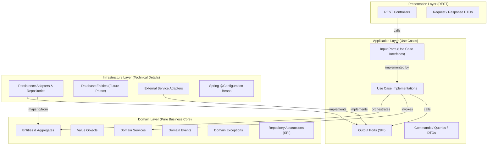
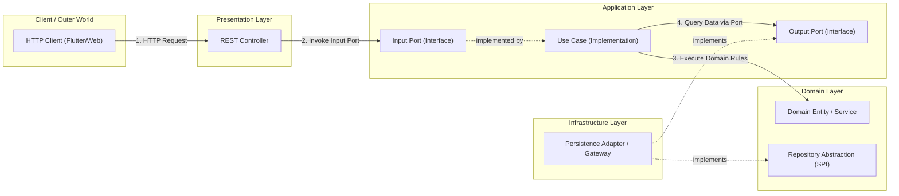
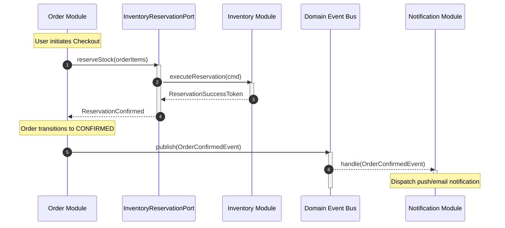

# Architectural Diagrams

## 1. Purpose
This section visualizes the architectural blueprints, layer interactions, and module boundary models for BazaarHub using standard Mermaid diagrams.

---

## 2. Clean Architecture Layer Ring Model

---

## 3. Dependency Inversion & Call Direction

> **Notice**: The compile-time source code dependency points inward (`Infrastructure -> Application / Domain`), while runtime execution flows outward through the output ports. This is the essence of the **Dependency Inversion Principle (DIP)**.

---

## 4. Cross-Module Communication Model

---

## 5. Maintenance
Maintained synchronously with architecture decisions. Diagrams must be updated whenever communication topologies or layer responsibilities change.
