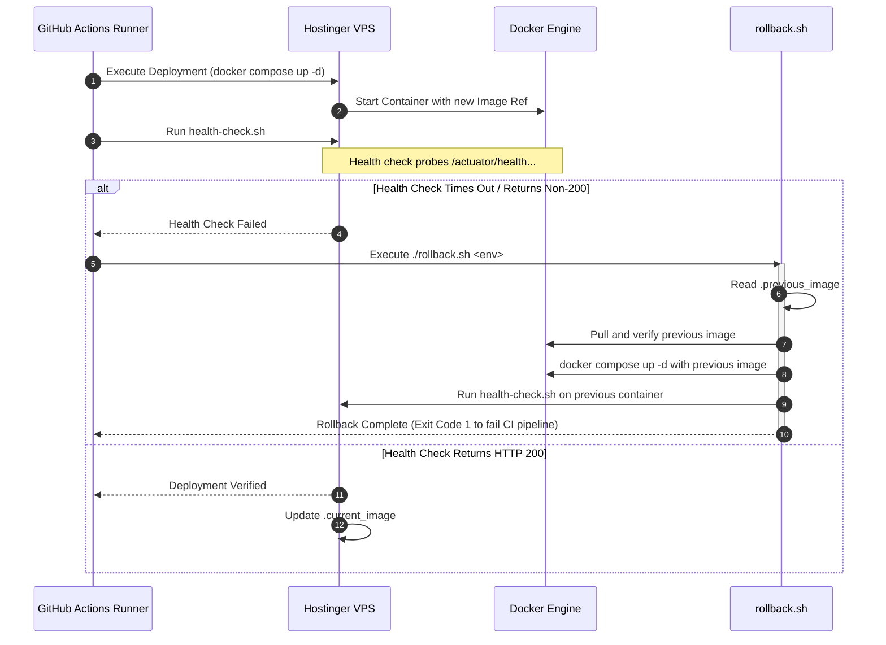

# Rollback Strategy & Recovery Guide

## 1. Overview
In enterprise deployments, rapid recovery from unexpected production defects (e.g. startup crashes, regression bugs) is vital.

BazaarHub implements an automated, scriptable rollback procedure that guarantees:
1. **Immediate State Reversion**: Reverts to the last known healthy container image using verified historical tags or digests.
2. **Data & Volume Protection**: Rollbacks never prune images, drop database schemas, or delete Docker persistent volumes.
3. **Transparent Operational Recovery**: Previous, failed, and active images are systematically tracked in local state files on the host.

> **Downtime Assessment Notice**: In our single-instance Docker Compose topology on a single VPS, container replacement involves a brief service interruption (approximately 3–8 seconds) while the JVM initializes. True zero-downtime requires multi-instance blue/green deployments or Kubernetes rolling updates with an upstream reverse proxy health gate (planned for Phase 4 scale-out).

---

## 2. Host State Tracking Architecture
Inside both `/opt/bazaarhub/staging/` and `/opt/bazaarhub/production/`, state is tracked using immutable local pointer files:

- `.current_image`: Holds the tag or digest of the currently active container image (e.g., `v1.0.1` or `sha256:...`).
- `.previous_image`: Holds the tag or digest of the immediately preceding healthy container image.
- `.failed_image`: Holds the reference of the image that failed deployment health probes, retained for investigation.

---

## 3. Automated Rollback Flow



---

## 4. Manual Rollback Procedure
If a production issue is detected post-deployment (e.g., subtle logical bug not caught by startup probes):

### Step 1: Connect to the Hostinger VPS
```bash
ssh -i ~/.ssh/bazaarhub_deploy_key deployer@<hostinger-vps-ip>
```

### Step 2: Navigate to Environment Directory
```bash
cd /opt/bazaarhub/production
```

### Step 3: Inspect Current & Previous Images
```bash
cat .current_image   # Active release (e.g. v1.0.1)
cat .previous_image  # Known healthy fallback (e.g. v1.0.0)
```

### Step 4: Execute Rollback Script
To roll back to the recorded previous release:
```bash
./rollback.sh production
```

To roll back to a specific immutable tag or digest:
```bash
./rollback.sh production v1.0.0
```

### Step 5: Verify Status & Logs
```bash
docker compose -f docker-compose.production.yml ps
docker compose -f docker-compose.production.yml logs -f --tail=50
```

---

## 5. Rollback Safety Rules
1. **Never Prune Retained Images During Rollback**: Deployment and rollback scripts do NOT run `docker image prune -a`.
2. **Persistent Volumes Are Untouched**: Container restarts do not touch database or upload volumes.
3. **Database Migration Compatibility (Phase 2+)**: Database schema changes must follow the expand-contract pattern so that rolled-back code versions remain compatible with the current database schema.
