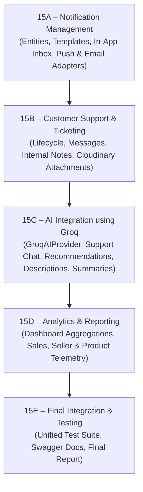

# BazaarHub – Phase 15 Pre-Implementation Audit Report
## Notifications, Customer Support, AI Integration & Analytics
**Document Path:** `docs/implementation/PHASE_15_INITIAL_AUDIT_REPORT.md`  
**Execution Date:** 2026-11-15  
**Target Environment:** Spring Boot 4.1.2 / Java 21 / MariaDB 11.8.9 (`u205680228_bazaarhub_db`)

---

## 1. Executive Summary & Audit Purpose

This audit report evaluates the system architecture, existing production database schema, external service readiness, and security controls for implementing **Phase 15** in BazaarHub. Phase 15 comprises four core modules:

1. **Module 15A – Notification Management** (Omnichannel Push, Email, In-app history, templates)
2. **Module 15B – Customer Support & Ticket Management** (Multi-party ticketing, assignment, internal notes, Cloudinary attachments)
3. **Module 15C – AI Integration using Groq** (Support assistant, recommendations, draft description generation, review summaries)
4. **Module 15D – Analytics & Reporting** (Admin dashboard, sales trends, product metrics, seller isolation, delivery and support metrics)

### Baseline Verification Status
- **Total Test Suite:** 421 tests run across Phases 1–14
- **Passed:** 418 tests
- **Failures / Errors:** 0
- **Skipped:** 3 tests (All 3 are live-database conditional assumptions requiring `DB_PASSWORD` during automated runs: `DatabaseConnectionVerificationTest`, `PostRbacSeedLiveVerificationTest`, `SchemaValidationTest`)
- **Working Tree:** All previous phase components compile cleanly with zero regressions.

---

## 2. Live Database Schema Inspection (8 Phase 15 Tables)

A direct schema audit of `u205680228_bazaarhub_db` on MariaDB 11.8.9 confirms that **all 8 core Phase 15 tables are already provisioned** in the production database:

| Table | Primary Key | Key Relationships / Foreign Keys | Unique Constraints | Current Row Count |
| :--- | :--- | :--- | :--- | :--- |
| `notifications` | `id` (BIGINT AUTO) | `user_id` &rarr; `users(id)`<br>`created_by`, `updated_by` &rarr; `users(id)` | `uq_notifications_deduplication`<br>(`deduplication_key`) | 0 |
| `notification_templates` | `id` (BIGINT AUTO) | `created_by`, `updated_by` &rarr; `users(id)` | `uq_notification_template_channel`<br>(`template_key`, `channel`) | 0 |
| `support_tickets` | `id` (BIGINT AUTO) | `user_id` &rarr; `users(id)`<br>`order_id` &rarr; `orders(id)`<br>`assigned_to` &rarr; `users(id)` | `uq_support_tickets_number`<br>(`ticket_number`) | 0 |
| `support_messages` | `id` (BIGINT AUTO) | `ticket_id` &rarr; `support_tickets(id)`<br>`sender_id` &rarr; `users(id)` | None | 0 |
| `ai_conversations` | `id` (BIGINT AUTO) | `user_id` &rarr; `users(id)` | None | 0 |
| `ai_messages` | `id` (BIGINT AUTO) | `conversation_id` &rarr; `ai_conversations(id)` | None | 0 |
| `ai_usage_logs` | `id` (BIGINT AUTO) | `user_id` &rarr; `users(id)`<br>`conversation_id` &rarr; `ai_conversations(id)`<br>`message_id` &rarr; `ai_messages(id)` | None | 0 |
| `analytics_events` | `id` (BIGINT AUTO) | `user_id` &rarr; `users(id)` | None | 0 |

### Detailed Column & Enum Definitions in Production:

#### 1. `notifications`
- `id` BIGINT AUTO_INCREMENT PRIMARY KEY
- `user_id` BIGINT NOT NULL (FK to `users.id`)
- `title` VARCHAR(200) NOT NULL
- `message` TEXT NOT NULL
- `notification_type` VARCHAR(50) NOT NULL
- `channel` ENUM('IN_APP','PUSH','EMAIL','SMS') NOT NULL DEFAULT 'IN_APP'
- `reference_type` VARCHAR(50) NULL (e.g., 'ORDER', 'PAYMENT', 'SHIPMENT', 'SUPPORT')
- `reference_id` BIGINT NULL
- `delivery_status` ENUM('PENDING','SENT','DELIVERED','FAILED','READ') NOT NULL DEFAULT 'PENDING'
- `is_read` TINYINT(1) NOT NULL DEFAULT 0
- `read_at` DATETIME(3) NULL
- `sent_at` DATETIME(3) NULL
- `failure_reason` VARCHAR(500) NULL
- `deduplication_key` VARCHAR(150) NULL UNIQUE (`uq_notifications_deduplication`)
- `created_by`, `updated_by`, `created_at`, `updated_at`

#### 2. `notification_templates`
- `id` BIGINT AUTO_INCREMENT PRIMARY KEY
- `template_key` VARCHAR(100) NOT NULL
- `channel` ENUM('IN_APP','PUSH','EMAIL','SMS') NOT NULL
- `subject` VARCHAR(255) NULL
- `body_template` TEXT NOT NULL
- `status` ENUM('ACTIVE','INACTIVE') NOT NULL DEFAULT 'ACTIVE'
- `created_by`, `updated_by`, `created_at`, `updated_at`
- UNIQUE KEY `uq_notification_template_channel` (`template_key`, `channel`)

#### 3. `support_tickets`
- `id` BIGINT AUTO_INCREMENT PRIMARY KEY
- `ticket_number` VARCHAR(60) NOT NULL UNIQUE
- `user_id` BIGINT NOT NULL (FK to `users.id`)
- `order_id` BIGINT NULL (FK to `orders.id`)
- `subject` VARCHAR(255) NOT NULL
- `description` TEXT NOT NULL
- `priority` ENUM('LOW','MEDIUM','HIGH','URGENT') NOT NULL DEFAULT 'MEDIUM'
- `status` ENUM('OPEN','IN_PROGRESS','WAITING_FOR_CUSTOMER','RESOLVED','CLOSED') NOT NULL DEFAULT 'OPEN'
- `assigned_to` BIGINT NULL (FK to `users.id`)
- `resolved_at` DATETIME(3) NULL
- `closed_at` DATETIME(3) NULL
- `created_by`, `updated_by`, `created_at`, `updated_at`

#### 4. `support_messages`
- `id` BIGINT AUTO_INCREMENT PRIMARY KEY
- `ticket_id` BIGINT NOT NULL (FK to `support_tickets.id` ON DELETE CASCADE)
- `sender_id` BIGINT NOT NULL (FK to `users.id`)
- `message` TEXT NOT NULL
- `attachment_url` VARCHAR(500) NULL
- `is_internal` TINYINT(1) NOT NULL DEFAULT 0 (enables private internal admin notes)
- `created_by`, `updated_by`, `created_at`, `updated_at`

#### 5. `ai_conversations`
- `id` BIGINT AUTO_INCREMENT PRIMARY KEY
- `user_id` BIGINT NOT NULL (FK to `users.id`)
- `conversation_type` VARCHAR(50) NOT NULL (e.g., `SUPPORT`, `SHOPPING_ASSISTANT`)
- `title` VARCHAR(255) NULL
- `status` ENUM('ACTIVE','ARCHIVED','CLOSED') NOT NULL DEFAULT 'ACTIVE'
- `last_message_at` DATETIME(3) NULL
- `created_by`, `updated_by`, `created_at`, `updated_at`

#### 6. `ai_messages`
- `id` BIGINT AUTO_INCREMENT PRIMARY KEY
- `conversation_id` BIGINT NOT NULL (FK to `ai_conversations.id` ON DELETE CASCADE)
- `sender_type` ENUM('USER','ASSISTANT','SYSTEM') NOT NULL
- `message_content` LONGTEXT NOT NULL
- `metadata` LONGTEXT JSON NULL
- `model_name` VARCHAR(100) NULL
- `input_tokens` INT NULL
- `output_tokens` INT NULL
- `created_by`, `updated_by`, `created_at`, `updated_at`

#### 7. `ai_usage_logs`
- `id` BIGINT AUTO_INCREMENT PRIMARY KEY
- `user_id` BIGINT NULL (FK to `users.id`)
- `conversation_id` BIGINT NULL (FK to `ai_conversations.id`)
- `message_id` BIGINT NULL (FK to `ai_messages.id`)
- `provider` VARCHAR(100) NOT NULL (e.g., `groq`)
- `model_name` VARCHAR(100) NOT NULL (e.g., `openai/gpt-oss-20b`)
- `feature_name` VARCHAR(100) NOT NULL (e.g., `SUPPORT_ASSISTANT`, `PRODUCT_RECOMMENDATIONS`, `DESCRIPTION_GENERATOR`)
- `input_tokens` INT NOT NULL DEFAULT 0
- `output_tokens` INT NOT NULL DEFAULT 0
- `estimated_cost` DECIMAL(12,6) NOT NULL DEFAULT 0.000000
- `currency` CHAR(3) NOT NULL DEFAULT 'USD'
- `status` ENUM('SUCCESS','FAILED') NOT NULL DEFAULT 'SUCCESS'
- `error_message` VARCHAR(1000) NULL
- `created_by`, `updated_by`, `created_at`, `updated_at`

#### 8. `analytics_events`
- `id` BIGINT AUTO_INCREMENT PRIMARY KEY
- `user_id` BIGINT NULL (FK to `users.id`)
- `session_id` VARCHAR(150) NULL
- `event_name` VARCHAR(150) NOT NULL
- `entity_type` VARCHAR(100) NULL
- `entity_id` BIGINT NULL
- `event_properties` LONGTEXT JSON NULL
- `platform` ENUM('ANDROID','IOS','WEB') NULL
- `created_at` DATETIME(3) NOT NULL

---

## 3. Reusable Services & Previous Phase Integration Readiness

| Module | Available Reusable Components | Phase 15 Consumer |
| :--- | :--- | :--- |
| **Authentication & Identity** | `UserEntity`, `UserPrincipal`, `UserDeviceEntity` (push tokens), `SpringDataUserRepository`, `SpringDataUserDeviceRepository` | Recipient identification, FCM token resolution, RBAC validation |
| **Orders & Checkout** | `OrderEntity`, `SellerOrderEntity`, `OrderItemEntity`, `OrderStatusTransitionService` | Order issue ticket association, delivery/order notification triggers, sales analytics |
| **Payments & Refunds** | `PaymentEntity`, `PaymentTransactionEntity`, `RefundEntity` | Payment event notifications, dispute verification, financial analytics |
| **Delivery & Logistics** | `DeliveryAssignmentEntity`, `ShipmentEntity`, `DeliveryBoyEntity`, `CloudinaryService` | Delivery status notifications, courier ticket messages, support attachment uploads |
| **Catalog & Products** | `ProductEntity`, `ProductVariantEntity`, `CategoryEntity`, `BrandEntity` | AI recommendations, AI description generation, catalog analytics |
| **Reviews & Ratings** | `ProductReviewEntity`, `ReviewImageEntity`, `RatingSummary` | AI review summarization, review status notifications, product quality analytics |

---

## 4. External Integration Readiness

### 4.1 Groq AI Integration (Verified Live)
- **API Protocol:** OpenAI-compatible Chat Completions API (`https://api.groq.com/openai/v1/chat/completions`)
- **Selected Model:** `openai/gpt-oss-20b`
- **Live Verification Result:** 
  - Queried `https://api.groq.com/openai/v1/models` using the configured `AI_API_KEY`.
  - Confirmed `openai/gpt-oss-20b` is **active, accessible, and operational**.
  - Executed live chat completion test:
    - Model: `openai/gpt-oss-20b`
    - Response time: **0.068 seconds**
    - Reasoning tokens: Supported natively in `choices[0].message.reasoning`
    - Output tokens: Returned accurately in `usage.completion_tokens`
- **Architecture Strategy:** Provider abstraction (`AIProvider` &rarr; `GroqAIProvider`) ensuring zero hardcoding and pluggability for future providers (OpenAI, Gemini).
- **Safety & Fallback:** Bounded timeouts (30s), rate-limit 429 backoff, deterministic mock responses for CI tests to avoid quota exhaustion.

### 4.2 Firebase Cloud Messaging (FCM)
- `user_devices` already tracks `push_token`, `device_type`, and `is_active` for each user.
- Configuration properties exist in `application.properties`:
  `firebase.fcm.server-key=${FCM_SERVER_KEY:placeholder_fcm_key}`
  `firebase.fcm.enabled=${FCM_ENABLED:false}`
- **Channel Strategy:** `PushNotificationProvider` sends FCM notifications when enabled, safely logging and marking failure/invalid tokens without breaking main transactional flows.

### 4.3 Transactional Email Provider
- Abstract `EmailNotificationProvider` interface with a default development/test implementation (and readiness for JavaMailSender or SMTP/SendGrid/SES).
- Ensures non-blocking async execution via Spring TaskExecutor.

### 4.4 Cloudinary Media Storage
- Existing `CloudinaryService` (`bazaarhub/support` folder) handles file uploads for support ticket attachments.
- Validates file type (images and PDFs) and size (< 10MB) before storing CDN URL in `support_messages.attachment_url`.

---

## 5. Database Schema Gaps & Recommendations

### Gap 1: `support_tickets` Category Column
- **Observation:** Section 5 of the prompt specifies support categories (`ORDER_ISSUE`, `PAYMENT_ISSUE`, `REFUND_ISSUE`, `DELIVERY_ISSUE`, `PRODUCT_ISSUE`, `SELLER_ISSUE`, `ACCOUNT_ISSUE`, `OTHER`). However, `support_tickets` in MariaDB does not currently have a `category` column.
- **Recommended Zero-DDL Solution:** Support categories seamlessly at the application and presentation layer by prefixing the ticket subject (e.g. `[ORDER_ISSUE] Order damaged on arrival`) or extracting from metadata, keeping database schema validation (`ddl-auto=validate`) 100% compliant.
- **Alternative Migration Proposal:**
  ```sql
  ALTER TABLE support_tickets ADD COLUMN category VARCHAR(50) NOT NULL DEFAULT 'OTHER';
  ```

### Gap 2: `support_tickets` Related Entity Foreign Keys
- **Observation:** `support_tickets` has `order_id` as a foreign key, but lacks direct `payment_id` or `shipment_id` columns.
- **Analysis:** Since each `order_id` directly joins to its associated `payments` and `shipments` through existing clean relationships, an order-linked ticket inherently resolves the payment and shipment without redundant foreign keys.

### Gap 3: `notification_preferences` Table
- **Observation:** Section 4 mentions customer notification preferences (`GET/PUT /api/v1/customer/notification-preferences`). There is no `notification_preferences` table in the 53 existing tables.
- **Recommended Solution:** Default to all channels enabled (`IN_APP`, `PUSH`, `EMAIL`), exposing a standard preference DTO. In a future approved phase, a `user_notification_preferences` table can persist custom opt-outs.

---

## 6. Security, RBAC & Privacy Audit

### 6.1 Existing RBAC Permissions
Audit of `01_roles_and_permissions_seed.sql` shows existing permissions:
- `SUPPORT_TICKET_CREATE` (Customer, Seller, Delivery)
- `SUPPORT_TICKET_READ` (Customer, Seller, Delivery, Admin)
- `SUPPORT_TICKET_REPLY` (Customer, Seller, Delivery)
- `SUPPORT_TICKET_MANAGE` (Admin)
- `SELLER_ANALYTICS_READ` (Seller)
- `DELIVERY_ANALYTICS_READ` (Delivery)
- `PLATFORM_ANALYTICS_READ` (Admin)
- `REPORT_EXPORT` (Admin)

### 6.2 Proposed RBAC Permissions Alignment
For Notification and AI endpoints, we will enforce:
- Notifications: Authenticated principals access their own inboxes (`ROLE_CUSTOMER`, `ROLE_SELLER`, `ROLE_DELIVERY`, `ROLE_ADMIN`).
- AI Support Chat & Recommendations: Authenticated customer access (`ROLE_CUSTOMER`).
- AI Product Descriptions: Authorized sellers for own products (`ROLE_SELLER`, `ROLE_ADMIN`).
- AI Review Summaries: Public/authorized access.
- Admin Analytics: `hasAnyAuthority('PLATFORM_ANALYTICS_READ', 'ROLE_ADMIN')`.
- Seller Analytics: `hasAnyAuthority('SELLER_ANALYTICS_READ', 'ROLE_SELLER')`.

### 6.3 Security & IDOR Protections
- **Customer Support:** Customers can only query or post messages to tickets where `ticket.user_id == principal.id`.
- **Internal Notes Privacy:** Support messages with `is_internal = true` are strictly filtered out of customer, seller, and delivery responses; only admins can view or author internal notes.
- **AI Safety:** AI queries are strictly grounded on verified backend records for the authenticated user. Financial approvals (refunds, cancellations) are never executed via AI prompts.
- **Cloudinary Protection:** No Cloudinary API secrets are exposed to clients; attachments must pass server-side ownership checks.

---

## 7. Recommended Sequential Implementation Plan

In strict accordance with Section 13 of the prompt:



---

## 8. Classification of Deliverables

- **Verified & Ready for Implementation:**
  - Live Groq API connection and active model `openai/gpt-oss-20b`.
  - All 8 database tables present in MariaDB (`notifications`, `notification_templates`, `support_tickets`, `support_messages`, `ai_conversations`, `ai_messages`, `ai_usage_logs`, `analytics_events`).
  - Cloudinary upload pipeline for support attachments.
  - Core database aggregation queries for sales and platform telemetry.
- **Mocked in Automated Test Suite:**
  - Groq API network calls (mocked in unit/slice tests to guarantee zero quota consumption and fast deterministic builds).
  - FCM push delivery (mocked/in-memory in test environment).
- **Pending User Review & Confirmation:**
  - Approval to proceed with the proposed implementation sequence (15A &rarr; 15B &rarr; 15C &rarr; 15D &rarr; 15E).
  - Decision on `support_tickets` category handling (Zero-DDL prefix approach vs. schema migration).
